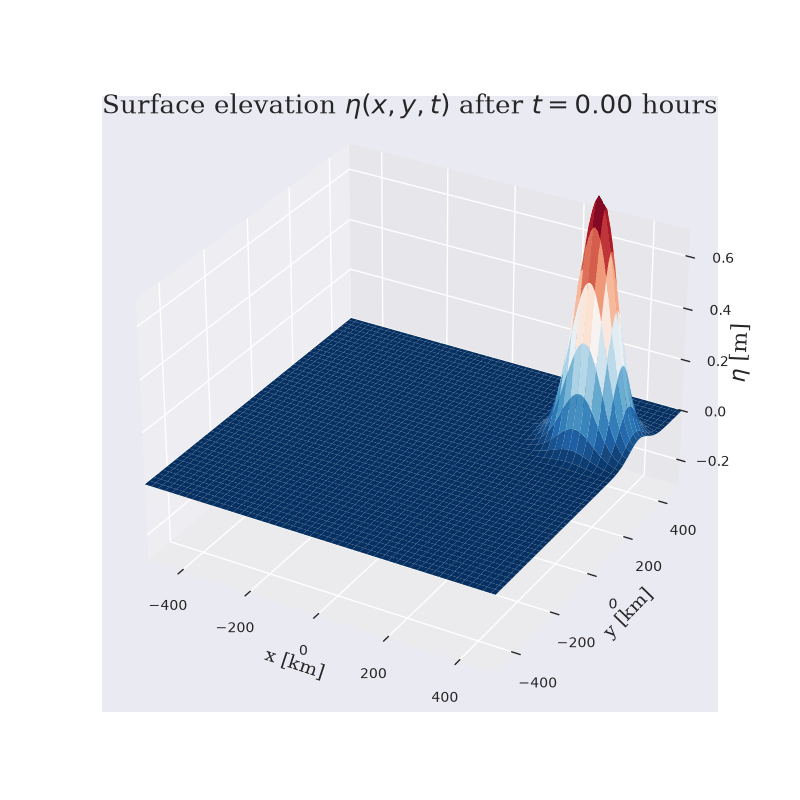
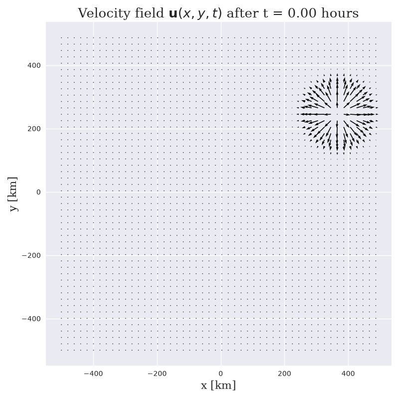

# Shallow water equations
Model solving the 2D [shallow water equations](https://en.wikipedia.org/wiki/Shallow_water_equations). The momentum equations are linearized while the continuity equation is solved non-linearly. The model was developed as part of the ["Bornö Summer School in Ocean Dynamics"](https://chess.w.uib.no/event/borno-summer-school-practice/) partly to study theory evolve in a numerical simulation. Visualizations scripts are also provided.

As it is set up right now, the model initates with a large gaussian bump resulting in waves propagate away from the bump, then interacts with the walls (no flow condition). The solution for the surface elevation and velocity fields can be seen below:

<div class="nav3" style="height:705px;">
    </a>
    </a>
</div>

The grid resolution is a command line parameter, so the same model can be run at several resolutions without editing the script:

```
python swe.py                    # default 150 x 150 grid
python swe.py -n 300             # 300 x 300 grid
python swe.py --nx 200 --ny 100  # different resolution per direction
```

Since the time step follows from the CFL condition, a finer grid gives a smaller `dt`, so the same number of time steps covers less simulated time; `--max-time-step` compensates. See `python swe.py --help` for the other options.

Every run also saves its fields to `swe_fields_nx<N_x>_ny<N_y>.npz` (and its parameter summary to `param_output_nx<N_x>_ny<N_y>.txt`), so runs at different resolutions can be compared afterwards without re-running the model:

```python
data = np.load("swe_fields_nx150_ny150.npz")
eta = data["eta"]        # snapshots of the surface elevation, shape (n_snapshots, N_x, N_y)
u, v = data["u"], data["v"]  # the velocity components at the same time steps
t = data["t"]            # time [s] of each snapshot, data["step"] for the step index
X, Y = data["X"], data["Y"]  # meshgrids, plus dx, dy, dt and the physical parameters
```

Snapshots are taken every `--save-interval` time steps (default: every 1000, i.e. 6 snapshots including the initial state). Pass `--save-interval 20` to store every animation frame instead — that is 250 frames of three fields, i.e. over 100 MB of data at the default resolution. `--no-save` skips the file.

Feel free to play around with the parameters to your liking. You might have to make some tweeks to the colorscale and arrowscale for some of the plots if you change some parameters.

## Status (2026-10-26)

| | |
| --- | --- |
| Role | The reference solver the `~/ws` projects started from; `swe-common` pins it as `references/shallow-water` for its parity test |
| Fixes | Eight latent bugs (friction slice, wind stress and others), fixed and recorded in `MODEL_NOTES.md` section 8 |
| Plan | The solver moves into `swe-common` (`~/ws/CLAUDE.md`, priority 6); nothing is repointed to it yet |
